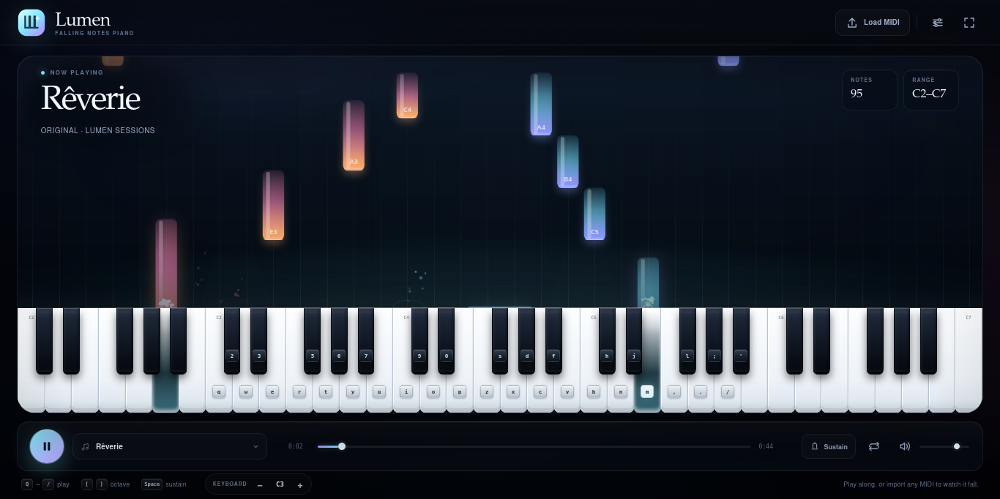

# Lumen — Falling Notes Piano

A cinematic, full-tab piano for Firefox. Glowing note tiles fall toward a playable five-octave keyboard, with guide hands, sparks, built-in arrangements, local MIDI import, and a silent **Training** mode for playing along. Everything runs offline.



## What’s new in 1.1

- **A real piano sound.** Lumen now ships with locally bundled Salamander Grand Piano samples instead of relying only on a synthesized approximation. The engine picks the nearest sampled note and pitch-shifts only a semitone or two, then normalizes the bank so the whole keyboard is present and loud.
- **Training mode.** Turn it on to keep the falling notes as a silent guide. The demo audio, automatic key highlights, and guide-hand movements are disabled; only the notes you play light up and move the hands.
- **Smoother rendering.** Notes, particles, the stage, and the hit line are pre-rendered and cached. The canvas resolution is budgeted for large displays, and the guide hands update at a lower, smoother cadence.
- **Cleaner MIDI.** Duplicate notes from multi-track exports are merged, and retriggering the same key damps the previous string instead of layering a doubled note.
- **Current Firefox requirements.** Firefox 140+ on desktop and Firefox for Android 142+.

## Install

**Temporary add-on**

1. Open `about:debugging#/runtime/this-firefox` in Firefox.
2. Click **Load Temporary Add-on…**.
3. Choose `manifest.json` (or the packaged `lumen-piano.xpi`).
4. Pin Lumen to the toolbar if it appears in the extensions panel.

The add-on stays loaded until Firefox restarts. Click the Lumen toolbar button to open the piano or focus its existing tab.

**Permanent install**

The package must be signed by Mozilla Add-ons (AMO) before release Firefox will install it permanently. Use the temporary route above for local use.

Lumen requires **Firefox 140 or newer** on desktop and **Firefox for Android 142 or newer**. The manifest declares `data_collection_permissions.required = ["none"]`; Firefox 140 is the first desktop release that understands that required AMO declaration.

## Play

| Input | Action |
| --- | --- |
| `Q W E R T Y U I O P Z X C V B N M , . /` | White keys |
| `2 3 5 6 7 9 0 S D F H J L ; '` | Black keys |
| `[` / `]` | Shift the keyboard mapping down / up by an octave |
| `Space` (hold) | Sustain pedal |
| Click or drag across keys | Play notes and glissando |
| Play button | Play or pause the selected song |
| Training button | Silent play-along guide (see below) |
| Settings button | Themes, speed, glow, volume, and layers |
| Fullscreen button | Enter or leave fullscreen |
| `Esc` | Close the settings panel |

The playable mapping starts at **C3** by default and covers **C3–A#5** (35 notes). Each row below runs chromatically from C to B:

```text
        C   C#  D   D#  E   F   F#  G   G#  A   A#  B
C3      Q   2   W   3   E   R   5   T   6   Y   7   U
C4      I   9   O   0   P   Z   S   X   D   C   F   V
C5      B   H   N   J   M   ,   L   .   ;   /   '   —
```

The default displayed keyboard spans **C2–C7**; imported songs can widen or narrow it. `[` and `]` transpose the mapped keys within the displayed range; the octave readout under the keyboard shows the current starting note. On narrow screens the small keycap labels are hidden so the keys remain touch-friendly.

## Training mode

Press **Training** next to Play, then press Play.

- **Training on:** the song is a silent guide. Its tiles keep falling, but Lumen does not play the demo, does not highlight the song’s keys, and does not move the guide hands. Play the notes yourself; your keys sound and your hands appear.
- **Training off:** the song plays normally, with its audio, automatic key highlights, and guide hands.

Training is saved with your other settings and works with built-in songs and imported MIDI.

## MIDI import

Use **Load MIDI** or drag a `.mid` / `.midi` file onto the page. Files are capped at 10 MB and 30,000 notes.

- Supports Standard MIDI File formats **0 and 1**
- Respects tempo changes and merges tracks
- Skips percussion on channel 10
- Merges duplicate notes that start on the same tick with the same pitch
- Expands the keyboard to fit the imported range, from A0 to C8
- Keeps everything local: files are parsed in the page and never uploaded

The song title comes from the filename. Invalid or empty files show an error and leave the current song loaded.

## Built-in songs

- **Rêverie** — an original arrangement, *Lumen Sessions*
- **Für Elise** — Ludwig van Beethoven, public domain
- **Gymnopédie** — after Erik Satie, public domain

## Settings

- **Aurora**, **Ember**, **Tide**, and **Mono** themes
- Fall speed, glow strength, and master volume
- Toggles for falling tiles, spark particles, guide hands, key hints, C note names, and ambient motion
- Loop playback, mute, and sustain on the transport
- Settings persist in local storage; **Reset to defaults** restores the original look

The guide hands are stylized translucent silhouettes, not a photographic hand overlay. They show which fingers are playing and can be turned off in Settings. Black keys use a raised fingertip target so the finger lands on the key instead of the white-key junction below it.

## Audio

The main piano is built from the **Salamander Grand Piano V3** sample set by Alexander Holm, used under [CC BY 3.0](https://creativecommons.org/licenses/by/3.0/). The files are bundled in `assets/piano/`; Lumen makes no external network requests. See `assets/piano/ATTRIBUTION.md` for details.

The engine chooses the nearest sample root, pitch-shifts by at most a semitone or two, normalizes the sample bank for even level across the keyboard, and uses a gentle compressor plus a final limiter. A lightweight synthesized fallback keeps the instrument usable if the samples cannot be loaded.

## Performance

The visual layer is designed to stay out of the audio’s way:

- Note tiles are drawn from a cached sprite atlas keyed by hand, state, width, and height.
- The lane background and hit line are rendered once to a separate base canvas.
- Particle and ring sprites are cached; particle arrays are updated in place.
- The canvas DPR is capped at 1.5 with a pixel budget and stretched to fill the stage.
- Guide-hand SVG paths update at about 40 fps and are positioned with transforms instead of per-frame layout reads.
- Expensive backdrop blur and large composited effects were removed.

In a 1366 px desktop test, idle and playing animation both stayed near the display refresh rate with no long tasks. Performance still depends on the browser, display, and number of enabled effects.

## Privacy

Lumen makes no external network requests and ships no remote scripts, fonts, or images. Piano samples are local extension assets. MIDI files and settings stay on your computer. The extension requests only the `storage` permission, used by the toolbar launcher to remember its tab; visual settings live in the page’s local storage.

## Preview without installing

```bash
cd lumen-piano
python3 -m http.server 8080
```

Open <http://localhost:8080/visualizer.html>. You can also open `visualizer.html` directly as a local file with `file://`; the toolbar launcher is only available when the extension is installed. Firefox blocks local file fetches from `file://` pages, so the direct-file preview uses the synthesized fallback; serve the folder over HTTP or install the extension for the sampled piano.

Audio starts after your first click or key press, as required by browser autoplay rules.

## Project layout

```text
manifest.json        Firefox extension manifest
background.js        Toolbar launcher and tab reuse
visualizer.html      Main instrument page
css/style.css        Layout, themes, keyboard, and chrome
js/app.js            App state, input, playback, settings, import
js/audio.js          Sampled piano, synth fallback, and reverb
js/visualizer.js     Canvas falling notes, glow, and particles
js/hands.js          Animated SVG guide hands
js/midi.js           Standard MIDI File parser
js/songs.js          Built-in arrangements
assets/grain.png     Generated film-grain texture
assets/piano/        Salamander Grand Piano samples and attribution
docs/screenshot.png  Preview image used above
```

There is no build step.

## Packaging

```bash
cd lumen-piano
zip -r lumen-piano.xpi . \
  -x "README.md" -x "CHANGELOG.md" -x "lumen-piano.xpi" \
  -x ".git/*" -x ".gitignore" -x "docs/*" -x "*.log"
```

For local testing, choose the resulting `.xpi` or `manifest.json` from `about:debugging`. Release Firefox requires a signed package; upload the `.xpi` to [addons.mozilla.org](https://addons.mozilla.org/developers/) to sign it.

## Credits

- **Salamander Grand Piano V3** — recorded by Alexander Holm, licensed under CC BY 3.0. Source: <https://github.com/sfzinstruments/SalamanderGrandPiano>. The bundled mono/32 kHz OGG files were derived from the Tone.js-hosted Salamander samples; see `assets/piano/ATTRIBUTION.md`.
- **Für Elise** — Ludwig van Beethoven, public domain.
- **Gymnopédie** — after Erik Satie, public domain.
- All other code and arrangements are released under the MIT License; see `LICENSE`.
# Lumen
